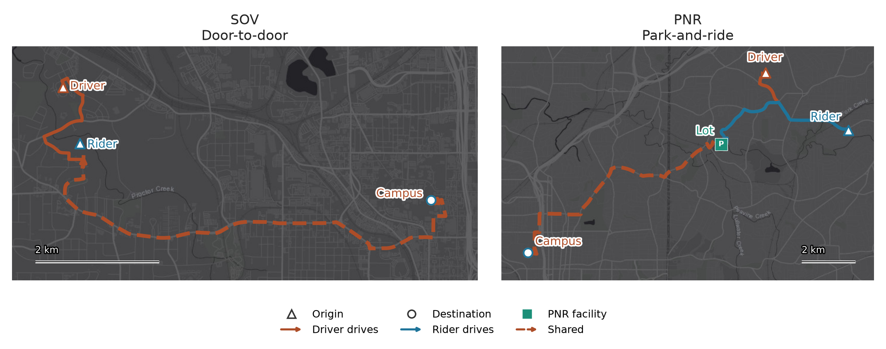
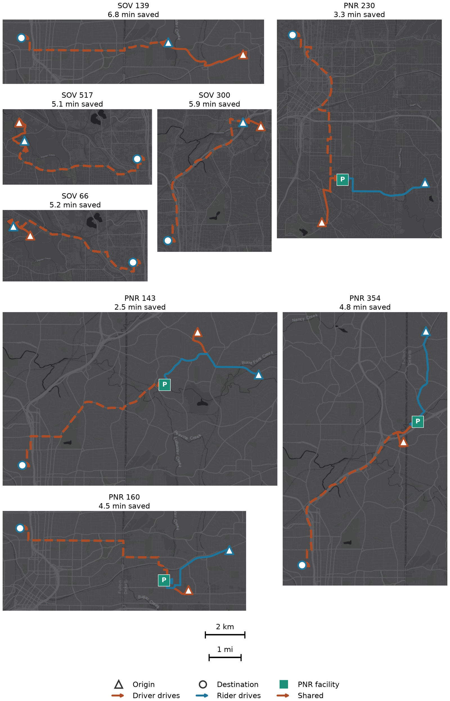
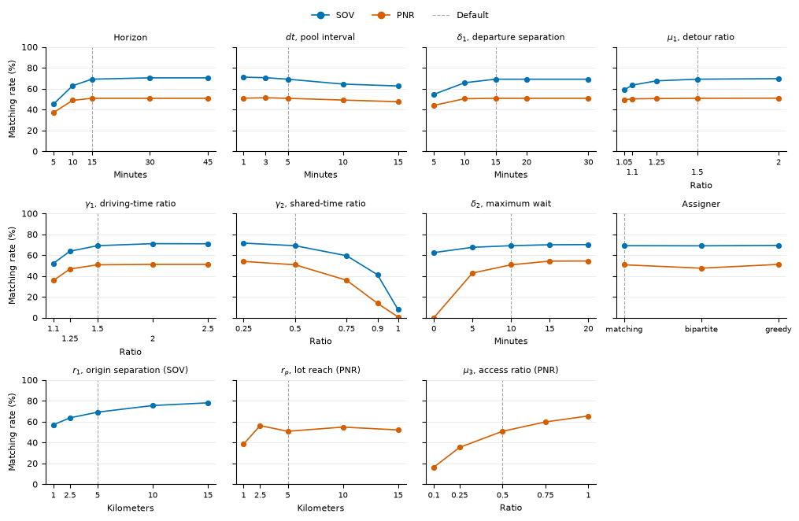
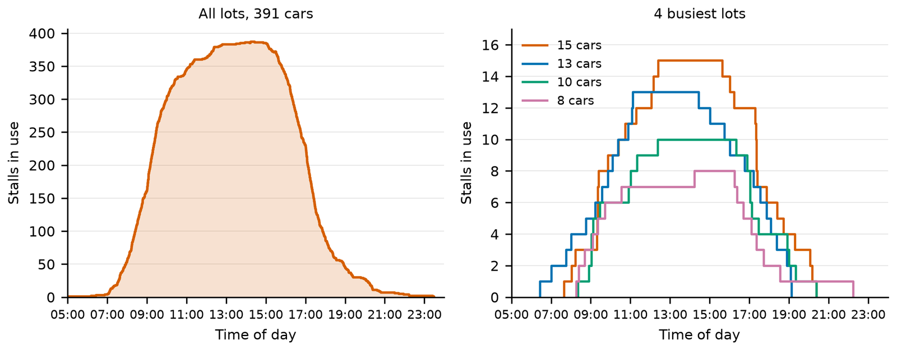
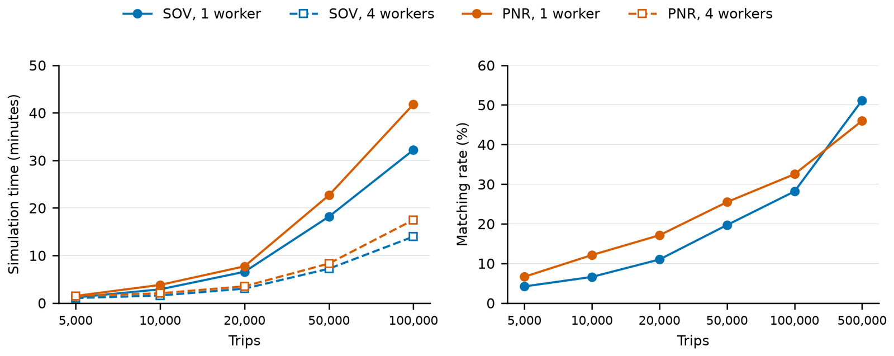

# carpoolsim

carpoolsim matches drive-alone trips into carpools. A clock walks through the day. At each step the travelers still waiting, and departing soon enough to share a ride, are matched. Filters turn off pairs that are too far apart, too late, or too costly. An assigner then keeps a conflict-free set of driver and rider pairs.

The packaged example is the Georgia Tech 2022 off-campus commute on an Atlanta street network. The same simulator also runs larger samples of morning drive-alone trips.

One door-to-door carpool (SOV) and one park-and-ride carpool (PNR) from that morning. On the left the driver picks the rider up at home, then they share the ride to campus. On the right each person drives to a public lot and they share the ride from there. Orange is the driver, blue is the rider, and the dashed line is the shared ride. Both end on campus, so the destination marks sit on the same point. Each bar is 2 km. The street map is Esri, HERE, Garmin, and OpenStreetMap contributors.



## How a day is matched

The clock starts at the earliest departure minus a look-ahead, `horizon`, and advances by a step, `dt`. Both are minutes. At clock `t` the pool holds every still-unmatched traveler whose departure lies in `[t, t + horizon]`.

Each pipeline, called a mode, then runs in the order given in the configuration. The travelers still unmatched are cut into groups of similar trips. The default group holds 100 travelers. Filters mark which pairs inside a group may share a ride. An assigner keeps a set in which each traveler has one seat. Both members of a committed pair leave the pool before the next mode runs. A traveler who is still unmatched after every mode, and whose departure the clock has passed, leaves alone.

`workers` is how many processes match those groups. The default is 1, which keeps the work in the current process. A larger number starts a process pool for the run and sends the router to each worker once.

Three assigners are built in:

- `matching` keeps the largest set of pairs in which every traveler has one seat.
- `bipartite` matches driver seats to rider seats, then drops pairs that would put one person in two cars.
- `greedy` takes feasible pairs in scan order and skips any traveler already used.

## Two ways to share a ride

A direct mode picks the rider up at the rider's origin, then drives both travelers to their destinations.

A park-and-ride mode sends both travelers to a public parking lot and shares the ride from there. `r_p` is the farthest an origin may be from a lot, in kilometers.

A run can use one mode or both. `config/gt_2022.yaml` is door-to-door. `config/gt_2022_pnr.yaml` is park-and-ride. `config/experiments/e21_both_direct_first.yaml` tries direct first, then park-and-ride for whoever is left.

Times in a configuration file are minutes. Distances such as `r1` and `r_p` are kilometers. A ratio such as `gamma_1` compares the carpool tour with the driver's own trip. The filter names and the rest of the settings are described in [docs/usage.md](docs/usage.md).

## Results

These figures use the Georgia Tech 2022 off-campus trips, 1,539 travelers. In the plots, SOV is door-to-door, PNR is park-and-ride, and Mixed tries door-to-door first.

| Mode | Match rate | Matched pairs | Vehicle-minutes saved | Mean detour (min) | Mean wait (min) | Mean access (min) |
| --- | ---: | ---: | ---: | ---: | ---: | ---: |
| SOV | 69.1% | 532 | 4,333 | 1.92 | 1.11 | 0.00 |
| PNR | 50.8% | 391 | 2,630 | 4.26 | 2.04 | 1.81 |
| Mixed | 76.7% | 590 | 4,592 | 2.67 | 1.40 | 0.48 |

SOV is `config/gt_2022.yaml`. PNR is `config/gt_2022_pnr.yaml`. Mixed is `config/experiments/e21_both_direct_first.yaml`.

Eight matched routes from those SOV and PNR runs. Each panel is one carpool, and a kilometer has the same length on every panel. The street map is Esri, HERE, Garmin, and OpenStreetMap contributors.



Matching rate when one setting changes and the others stay at the baseline. The dashed line marks that baseline.



Park-and-ride stalls in use through the day, for every lot and for the four busiest lots.



Run time and matching rate on larger morning drive-alone samples. The time panel runs through 100,000 trips. The matching-rate panel runs through 500,000 trips.



## Repository layout

| Path | What it holds |
|---|---|
| `carpoolsim/` | The library: trips, filters, assigners, the clock, and the street network |
| `config/` | Scenario files and the one-factor experiment suite |
| `evaluation/` | Scores, itineraries, and plots for a finished run |
| `scripts/` | Build the experiment plan, and run the experiment notebooks |
| `app/` | A Streamlit demo for the Georgia Tech day |
| `tests/` | Tests |
| `docs/` | Sphinx sources |
| `static/` | Figures embedded in this README |
| `data_inputs/osm/README.md` | How to build the Atlanta street and parking-lot extract |

Street networks, trip tables, and run results stay on disk under `data_inputs/` and `data_outputs/`. They are not part of the source tree.

## Install

Python 3.11 or newer. From a checkout of this repository:

```bash
uv sync
```

The docs extra adds Sphinx. The app extra adds Streamlit. The test extra adds pytest.

```bash
uv sync --extra docs --extra app --extra test
```

## Run one configuration

Trip rows are EPSG:3857 meters. `departure_time` is `HH:MM`. Columns are `origin_x`, `origin_y`, `dest_x`, `dest_y`, and `departure_time`. `trip_id` is optional. The network tables are the GeoPackages written by `save_network`.

```python
from carpoolsim.config import load_config
from carpoolsim.map_loader import load_network
from carpoolsim.network_prep import RoadRouter
from carpoolsim.trip_cluster import TripCluster

config = load_config("config/gt_2022.yaml")
trips = TripCluster.from_csv("trips.csv")
nodes, edges = load_network("data_inputs/network")
router = RoadRouter(nodes, edges)

simulator = config.build(trips, router=router)
simulator.run()
```

`simulator.matches` holds each committed pair. `driver` and `rider` are traveler ids, `t` is minutes after midnight, and `mode` is the pipeline that produced the pair. `simulator.solos` holds travelers who left without a partner.

A park-and-ride file also needs lot coordinates. Build the Atlanta extract with the steps in [data_inputs/osm/README.md](data_inputs/osm/README.md), then follow the park-and-ride example in [docs/usage.md](docs/usage.md).

## Experiments

`config/experiments/` holds one YAML file per one-factor change from the Georgia Tech door-to-door baseline or the park-and-ride baseline. `config/experiments/manifest.csv` lists each change, the baseline it comes from, and where its notebook and output go.

`config/mass_sov.yaml` and `config/mass_pnr.yaml` are the settings used for larger morning drive-alone samples. `data_inputs/trip_mass/build_sov_trips.py` builds those trip tables.

## Demo

With the app extra installed, and the saved Georgia Tech results on disk (`data_outputs/gt_2022` needs `travelers.csv`, `matches.csv`, and `legs.gpkg`):

```bash
uv run streamlit run app/Home.py
```

The demo shows the matched routes from that saved run. It does not match a new day.

## Documentation and tests

```bash
uv run sphinx-build -b html docs docs/_build/html
uv run pytest
```

Open `docs/_build/html/index.html`. Read the Docs rebuilds the same site from `.readthedocs.yaml`.

## License

This project is licensed under the MIT License. See [LICENSE](LICENSE).
